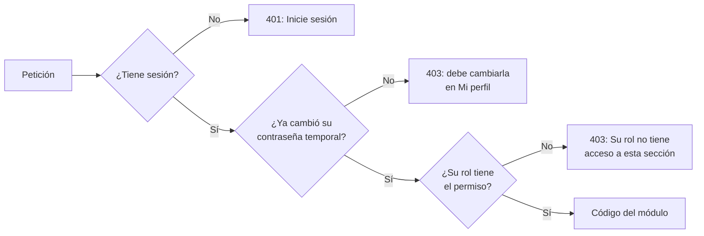

# Usuarios y roles: guía para programar

Guía corta para el equipo. Explica cómo entra un usuario, cómo se decide qué puede hacer y
qué tiene que hacer quien programa un módulo nuevo. El detalle técnico completo está en
[ARCHITECTURE.md](ARCHITECTURE.md#acceso-a-la-api-y-roles-hu-11--hu-15).

## 1. La idea en una frase

**Cada usuario tiene un rol, cada rol tiene permisos, y el servidor revisa el permiso en
cada petición.** El menú solo esconde lo que el rol no puede usar, para que se vea ordenado;
la seguridad de verdad está en el servidor.

## 2. Los roles

| Rol           | Qué puede usar                                                   |
| ------------- | ---------------------------------------------------------------- |
| Administrador | Todo, incluida la Configuración (usuarios)                       |
| Encargado     | Todo el negocio, menos la Configuración                          |
| Cajero        | Ventas y clientes; consulta productos sin modificarlos           |
| Bodega        | Inventario, kardex, pedidos a proveedor y reportes de inventario |

Los roles son fijos. La lista exacta de permisos de cada uno está en **un solo archivo**:
`backend/src/auth/permissions.ts`.

## 3. De dónde sale el primer usuario

No hay pantalla de registro. El primer administrador se crea desde la terminal:

1. En `backend/.env` se ponen `ADMIN_NAME`, `ADMIN_EMAIL` y `ADMIN_PASSWORD`
   (hay un ejemplo en `backend/.env.example`).
2. Se corre `npm run db:seed`.
3. Al entrar por primera vez, el sistema obliga a cambiar esa contraseña.

Si el backend arranca sin ningún administrador activo, lo avisa en su terminal con estos
mismos pasos. Los demás usuarios los crea el administrador en **Configuración › Usuarios**.

## 4. Qué pasa en cada petición

Cuando la pantalla pide datos (por ejemplo, la lista de pedidos), el servidor revisa tres
cosas, en orden, antes de llegar al código del módulo:



En el código, eso está en `backend/src/routes/index.ts`:

```ts
apiRouter.use('/purchase-orders', ...sessionRequired, requirePermission('purchasing'), purchaseOrdersRouter);
```

- `sessionRequired` revisa la sesión y la contraseña temporal.
- `requirePermission('purchasing')` revisa el permiso. Con dos permisos,
  `requirePermission('inventory.read', 'inventory.write')`, el primero sirve para consultar
  (`GET`) y el segundo para crear, modificar o borrar.

## 5. Si programo un módulo nuevo

Ejemplo: un módulo de **Reportes de ventas**.

1. **Permiso.** Si no existe, se agrega en `backend/src/auth/permissions.ts` y se asigna a
   los roles que correspondan. Para reportes de ventas ya existe `reports.sales`.
2. **API.** Se monta el router en `backend/src/routes/index.ts` con su permiso:
   ```ts
   apiRouter.use('/sales-reports', ...sessionRequired, requirePermission('reports.sales'), salesReportsRouter);
   ```
3. **Menú.** En `frontend/src/layouts/navigation.ts`, la opción lleva el mismo permiso:
   `permission: 'reports.sales'`.
4. **Ruta.** En `frontend/src/app/routes.tsx`, la pantalla se envuelve igual:
   `only('reports.sales', <SalesReportsPage />)`.
5. **Pantallas compartidas.** Si un dato aparece en una pantalla que ven varios roles (por
   ejemplo, el panel de Inicio), solo se pide si el rol tiene el permiso:
   ```ts
   const { can } = useSession();
   if (can('reports.sales')) { /* pedir y mostrar los datos */ }
   ```
   Si no se hace, la API responde 403 a los otros roles y la pantalla falla para ellos.
   Ya pasó con el resumen de ventas del panel y Bodega.

Los permisos del frontend tienen que ser **los mismos** del backend. Si un permiso solo se
pone en el menú, cualquiera podría llamar a la API directamente.

## 6. Cómo probar con varios roles

1. Entrar como administrador y, en **Configuración › Usuarios**, crear un usuario por rol
   (por ejemplo `cajero@prueba.local` y `bodega@prueba.local`).
2. El sistema muestra una contraseña temporal una sola vez. Se anota y se usa para entrar
   con ese usuario; en el primer ingreso pide cambiarla.
3. Revisar con cada rol:
   - el menú muestra solo lo suyo;
   - escribir a mano la dirección de una pantalla ajena muestra «Acceso no permitido»;
   - el panel de Inicio carga sin errores.

Para no estar cerrando sesión, se puede usar una ventana normal para un usuario y una
ventana de incógnito para otro.

## 7. Preguntas frecuentes

**«Correo o contraseña incorrectos» y estoy seguro de los datos.**
Los usuarios viven en la base de **cada computadora**. Si en la suya no existe ese usuario,
corra `npm run db:seed` (ver punto 3). La terminal del backend avisa si no hay ningún
administrador.

**Olvidé la contraseña del administrador en mi máquina.**
Borre los usuarios de **su** base local y créelo de nuevo:

```bash
docker exec minisuper-postgres psql -U minisuper -d minisuper -c 'DELETE FROM "User";'
npm run db:seed
```

**Le cambié el rol a alguien y lo sacó del sistema.**
Es a propósito: al cambiar el rol, desactivar a alguien o restablecerle la contraseña, se
cierran sus sesiones abiertas. Al volver a entrar ya tiene los permisos nuevos.

**¿Puedo borrar un usuario?**
No: se desactiva. Así no puede entrar, pero se conservan sus datos y se puede reactivar.
