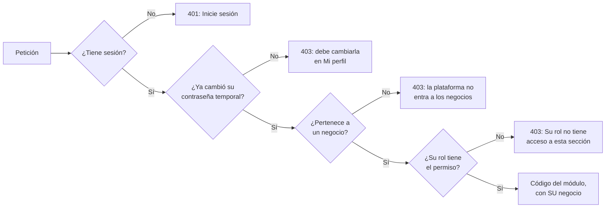

# Usuarios y roles: guía para programar

Guía corta para el equipo. Explica cómo entra un usuario, cómo se decide qué puede hacer y
qué tiene que hacer quien programa un módulo nuevo. El detalle técnico completo está en
[ARCHITECTURE.md](ARCHITECTURE.md#acceso-a-la-api-y-roles-hu-11--hu-15).

## 1. La idea en una frase

**Cada usuario tiene un rol, cada rol tiene permisos, y el servidor revisa el permiso en
cada petición.** El menú solo esconde lo que el rol no puede usar, para que se vea ordenado;
la seguridad de verdad está en el servidor.

## 2. Los roles

| Rol           | Qué puede usar                                                                 |
| ------------- | ------------------------------------------------------------------------------ |
| Administrador | La **plataforma**: negocios clientes, sus planes y solicitudes, nombre del sistema. **No** ve datos de ningún negocio |
| Encargado     | Dueño de **su** negocio: todo el negocio, sus datos y logo, su Cajero y Bodega |
| Cajero        | Ventas y clientes; consulta productos sin modificarlos                         |
| Bodega        | Inventario, kardex, pedidos a proveedor y reportes de inventario               |

Los roles son fijos. La lista exacta de permisos de cada uno está en **un solo archivo**:
`backend/src/auth/permissions.ts`.

**Jerarquía:**

```
Administrador (la plataforma)  →  crea negocios con su Encargado, cambia planes, responde solicitudes
   Encargado (dueño del negocio)  →  maneja solo a Cajero y Bodega de SU negocio
      Cajero / Bodega  →  no manejan usuarios
```

**Varios negocios.** Cada negocio tiene sus propios productos, ventas, clientes y
usuarios. Nadie de un negocio ve los datos de otro, y el Administrador no ve los de
ninguno: para probar los módulos, el equipo se crea un **Encargado** (ver punto 6).

**El plan** es «Encargado + N»: plan 0 es solo el Encargado, y cada nivel suma un usuario.
Si está lleno, el Encargado pide más en **Configuración › General › Solicitar más
usuarios**; la solicitud llega a la bandeja del Administrador (**Solicitudes**) y, al
aprobarla, el Encargado ya puede crearlos. La razón de este diseño está en
[adr/0002-usuarios-jerarquia-y-plan.md](adr/0002-usuarios-jerarquia-y-plan.md).

**La ventana de Configuración** muestra a cada rol sus pestañas:

| Pestaña | Administrador | Encargado | Cajero / Bodega |
| --- | --- | --- | --- |
| General (datos, logo y plan del negocio) | — | ✅ el suyo | — |
| Plataforma (nombre del sistema, precio por usuario) | ✅ | — | — |
| Usuarios | ✅ administradores y Encargados | ✅ Cajero y Bodega de su negocio | — |
| Apariencia (color, letra) | ✅ la suya | ✅ la suya | ✅ la suya |

## 3. De dónde salen los usuarios

No hay pantalla de registro. El primer **Administrador** se crea desde la terminal:

1. En `backend/.env` se ponen `ADMIN_NAME`, `ADMIN_EMAIL` y `ADMIN_PASSWORD`
   (hay un ejemplo en `backend/.env.example`).
2. Se corre `npm run db:seed`.
3. Al entrar por primera vez, el sistema obliga a cambiar esa contraseña.

Si el backend arranca sin ningún administrador activo, lo avisa en su terminal con estos
mismos pasos. Después:

- el Administrador crea cada **negocio con su Encargado** en **Negocios › + Nuevo
  negocio** (el sistema muestra la contraseña temporal del Encargado una sola vez);
- el Encargado crea a su personal en **Configuración › Usuarios**.

## 4. Qué pasa en cada petición

Cuando la pantalla pide datos (por ejemplo, la lista de pedidos), el servidor revisa tres
cosas, en orden, antes de llegar al código del módulo:



En el código, eso está en `backend/src/routes/index.ts`:

```ts
apiRouter.use('/purchase-orders', ...businessRequired, requirePermission('purchasing'), purchaseOrdersRouter);
```

- `businessRequired` revisa la sesión, la contraseña temporal y que el usuario sea de un
  negocio (`sessionRequired` es lo mismo sin lo del negocio; lo usan la plataforma y
  «Mi perfil»).
- `requirePermission('purchasing')` revisa el permiso. Con dos permisos,
  `requirePermission('inventory.read', 'inventory.write')`, el primero sirve para consultar
  (`GET`) y el segundo para crear, modificar o borrar.

## 5. Si programo un módulo nuevo

Ejemplo: un módulo de **Reportes de ventas**.

1. **Permiso.** Si no existe, se agrega en `backend/src/auth/permissions.ts` y se asigna a
   los roles que correspondan. Para reportes de ventas ya existe `reports.sales`.
2. **Repositorio atado al negocio.** El repositorio recibe el negocio al construirse y
   **todas** sus consultas filtran por él (así lo hacen todos los módulos; por ejemplo,
   `categories.repository.ts`):
   ```ts
   export class SalesReportsRepository {
     constructor(readonly businessId: string) {}

     async totals() {
       return prisma.sale.findMany({ where: { businessId: this.businessId }, ... });
     }
   }
   ```
   El controller pide el servicio del negocio de la sesión con
   `this.serviceFor(businessIdOf(res))`, y el router se arma con
   `(businessId) => new SalesReportsRepository(businessId)`. El `businessId` sale **siempre
   de la sesión**, nunca del cuerpo ni de la URL. Si la tabla es nueva y es «raíz» (no
   cuelga de otra), lleva su columna `businessId`; agregue una prueba en
   `tenant-isolation.integration.test.ts`.
3. **API.** Se monta el router en `backend/src/routes/index.ts` con su permiso:
   ```ts
   apiRouter.use('/sales-reports', ...businessRequired, requirePermission('reports.sales'), salesReportsRouter);
   ```
4. **Menú.** En `frontend/src/layouts/navigation.ts`, la opción lleva el mismo permiso:
   `permission: 'reports.sales'`.
5. **Ruta.** En `frontend/src/app/routes.tsx`, la pantalla se envuelve igual:
   `only('reports.sales', <SalesReportsPage />)`.
6. **Pantallas compartidas.** Si un dato aparece en una pantalla que ven varios roles (por
   ejemplo, el panel de Inicio), solo se pide si el rol tiene el permiso:
   ```ts
   const { can } = useSession();
   if (can('reports.sales')) { /* pedir y mostrar los datos */ }
   ```
   Si no se hace, la API responde 403 a los otros roles y la pantalla falla para ellos.
   Ya pasó con el resumen de ventas del panel y Bodega.

Los permisos del frontend tienen que ser **los mismos** del backend. Si un permiso solo se
pone en el menú, cualquiera podría llamar a la API directamente.

## 6. Cómo probar con varios roles

1. Entrar como **Administrador**: el inicio es **Negocios**. Crear un negocio de prueba
   con su Encargado (por ejemplo `encargado@prueba.local`) y un plan de 2 o más usuarios
   adicionales. Anotar la contraseña temporal que se muestra.
2. Entrar como ese **Encargado** (en el primer ingreso pide cambiar la contraseña). Con él
   se prueban todos los módulos del negocio.
3. En **Configuración › Usuarios**, el Encargado crea un Cajero y un Bodega y se revisa con
   cada uno:
   - el menú muestra solo lo suyo;
   - escribir a mano la dirección de una pantalla ajena muestra «Acceso no permitido»;
   - el panel de Inicio carga sin errores.

Para no estar cerrando sesión, se puede usar una ventana normal para un usuario y una
ventana de incógnito para otro.

## 7. Preguntas frecuentes

**«Correo o contraseña incorrectos» y estoy seguro de los datos.**
Los usuarios viven en la base de **cada computadora**. Si en la suya no existe ese usuario,
corra `npm run db:seed` (ver punto 3). La terminal del backend avisa si no hay ningún
administrador.

**Olvidé la contraseña del administrador en mi máquina.**
Borre los usuarios de **su** base local y créelo de nuevo:

```bash
docker exec minisuper-postgres psql -U minisuper -d minisuper -c 'DELETE FROM "User";'
npm run db:seed
```

**Le cambié el rol a alguien y lo sacó del sistema.**
Es a propósito: al cambiar el rol, desactivar a alguien o restablecerle la contraseña, se
cierran sus sesiones abiertas. Al volver a entrar ya tiene los permisos nuevos.

**«El plan permite N usuarios activos y ya están en uso».**
El negocio llegó al límite de su plan. Desactive a alguien que ya no trabaje ahí, o pida
más usuarios en Configuración › General › Solicitar más usuarios.

**Entro como Administrador y no veo productos ni ventas.**
Es a propósito: la plataforma no ve los datos de sus clientes. Entre con un Encargado
(punto 6). Después de esta actualización, sus datos de antes quedaron en un negocio creado
por la migración: en **Negocios** créele un Encargado (Usuarios › Nuevo usuario › rol
Encargado › ese negocio) y entre con él.

**«El acceso de su negocio está suspendido».**
El Administrador suspendió ese negocio en **Negocios**. Sus datos siguen ahí: al
reactivarlo, todo vuelve a funcionar.

**Mi consulta devuelve datos de otro negocio.**
Le falta el filtro `businessId: this.businessId` (o `AND "businessId" = ${this.businessId}::uuid`
en SQL directo). Toda consulta de un repositorio de negocio lo lleva.

**Si mi módulo usa un permiso nuevo para administrar algo de otros usuarios**, aplique
también la jerarquía en el service con `canManageRole` (ver `users.service.ts`): no basta
con el permiso de la ruta.

**¿Puedo borrar un usuario?**
No: se desactiva. Así no puede entrar, pero se conservan sus datos y se puede reactivar.
